# Interface audit — November 2026

The owner asked for the interface to be looked at as a whole: what is broken,
what is overloaded, and what is simply awkward to use. This is the record of
that audit — how it was done, what was fixed, and what is waiting on a
decision — so that whoever picks it up next starts from here rather than from
scratch.

Fixed in two commits on `claude/tech-reporting-webapp-0ks9r8`:

- `15969b8` — first pass: what was wrong on screen, and what was in the way
- `9d8bc31` — second pass: narrow screens, the 404, and the clock picker

Neither changes the database, so deploying them is the usual update in
[DEPLOYMENT.md](../DEPLOYMENT.md#updating). Every suite passed on the build
both commits were made from: verify 796 checks, verify:ui 374,
verify:profiles 164, verify:approvals 162, verify:deliverables 115,
verify:forms 81, verify:pay 53, verify:form-pages 48, verify:images 45,
verify:signin 43, verify:auth 39, verify:draft 26, verify:budget 7.

## How it was looked at

- **As each kind of user**: tech, supervisor, manager and administrator — the
  fixture accounts `tech@`, `sup@`, `boss@` and `admin@417group.org`.
- **At four widths**: 390 px (a phone), 320 px (a small phone, or any phone
  with its text set larger), 820 px (a tablet) and 1440 px (a desktop); in the
  dark theme everywhere and the light theme on phones.
- **On believable data** (`scripts/ui-audit/demo-data.ts`): nine people, four
  paying companies, five customers, three projects and about twenty-five jobs in
  every state from a tech's ad-hoc request to a paid week, with visits, breaks,
  claims, mileage, payroll weeks and change requests.
- **A tech's day, clicked through on a phone** (`walk-tech.ts`): open the job,
  clock in, take a break, tick the scope, file photos, check out with both
  signatures, clock out.
- **Measured on every page** (`crawl.ts`): sideways scrolling, anything wider
  than the screen, tap targets under 44 px, text cut short, broken images,
  console errors, failed requests, a sentence split into columns by a flex row,
  and grid columns grown wider than their container.

## Fixed

### Wrong, or losing what somebody entered

- **Checkout signatures.** The pad wiped itself on any window resize — the
  keyboard opening for the MOD's position, the browser bar sliding away on the
  way down to Continue — and Continue on the empty pad then recorded "no
  signature" while the summary said "Captured". The pad now resets only when its
  own width changes; going on without ink is a button that says so ("Continue
  without a signature"); a skipped signature reads "Not signed"; signing again
  replaces it; a MOD typed in at checkout is the contact the signature is kept
  against.
- **Photo uploads.** Each pick replaced the last, so three photos taken with the
  camera one at a time left one. Picks now add up, show as thumbnails before
  Save, and can be left out one by one; a retry after a dropped connection
  sends only what is left, into the same upload.
- **Project pages turned away everybody who only works on the project**, though
  the Projects list, the dashboard, the project's name on each of their jobs and
  the "You are on the … project" notice all link there. Members, and anybody
  with a job in it, now get a read-only page: scope, contacts, crew and their
  own jobs — no settings, pay or history.
- **Change requests were printed as stored**: a site's database id, an ISO
  timestamp, `visit.<id>.clockOut` on the badge. They read as a site number, a
  time on the site's clock, "in 6:35 AM, out 11:45 AM", "4.00 hrs → 5.50 hrs" —
  on the job page, all three Approvals tabs and the two forms' "Waiting on
  approval" line (`src/lib/change-request-display.ts`). Approvals also shows the
  requester's reason.
- **The clock picker's five times.** "10:35 AM" is wider than a fifth of a
  phone, so from ten o'clock on every label ran into its neighbours — on Clock in
  and Clock out, every morning. The half of the day now sits under the time on
  phones.
- **A page that is not there** showed the framework's white "404" inside the dark
  app, and its stylesheet turned the company name in the header black. A tech
  taken off a job meets it from an old notification. Both not-found pages are
  the app's own now, with a way back.
- **Directory**: typing a real number for a site still marked "number pending"
  never cleared the mark. On screen a pending site reads "SBUX — number pending"
  rather than its placeholder; exports and calendars are unchanged.
- Smaller ones: the dashboard's week ran to the Monday after ("11/9 – 11/16");
  "0 min of unpaid break deducted"; 3.50 and 3.75 hours on one page with neither
  labelled (now "on site" and "paid"); a tech's back link on a site page led to
  a page they cannot open; the site page showed a raw zone id; review copy
  counted four passes of five and hid the selected pass's icon; the manager's
  dashboard scrolled sideways at 320 px; the pay week card broke its dates one
  word to a line below 360 px; a profile read on a phone had every label at the
  right-hand edge over a value at the left; work order numbers broke at a hyphen
  in page headers; an empty `CALDAV_USERNAME` read as set on Integrations, and
  the redirect URI pushed that page sideways.

### In the way

- **Settings → Users** was every account's whole form, open, one after another:
  12,049 px on a phone for nine people. Now a line each — role, who they report
  to, last sign-in — opening onto the form, with a search box (about 1,300 px).
- **Job lists** (Jobs, a project's jobs, the dashboard week) closed each row with
  the time, which is the part a phone cut off ("11-07-2026 6:3…"). The time comes
  first; the viewer's own name is left off their own list.
- **A report waiting for review** has a "Review report" banner for whoever can
  approve it, instead of ⋯ → Manager Portal → Review report.
- **Checkout** starts every step at the top of the screen. Continue was below the
  fold on the signature steps, and the way down to it was a swipe across the pad.
- **Deleting asks first** where one tap took files or set-up with it: a mileage
  trip and its odometer photos, a claim and its receipts, a job document, a
  company's blank and its autofill mapping, a pay rate.
- **Page headers** no longer wrap the title one word to a line beside two
  buttons, nor drop a lone button below it at 320 px.
- Words rather than enums: roles, project status and outcomes in title case;
  "Resubmit for review" under "Sent back for changes"; "You are on …" says when
  and where, since a project's jobs share one title; a tech is told to attach a
  sign-off sheet they were sent rather than to go to the directory.

### Checked and fine

The light theme on every screen (tech and manager), every screen at 320 px
other than the dashboard above, no console errors anywhere, no failed requests
other than the 404s the crawl asks for on purpose.

Not a bug: the gap on `/account` in full-page screenshots is the sticky save
bar's place.

Not gone through one by one: the crawl counts many controls under 44 px — up
to about twenty-five on a job page, mostly inline links and icon buttons in
dense rows. Each report's `smallTargets` lists them.

## Open — waiting on the owner

The eleven proposals put to the owner, and their answers (11 November 2026).

| # | Proposal | Answer |
| --- | --- | --- |
| 1 | Tell the crew a job is raised with ("You are on …"), not only people added later | **Done** — `4a58c8e` |
| 2 | A count on the Approvals tab in the navigation | **Done** — `4a58c8e` |
| 3 | Fold runs of empty "No work" weeks on Pay into one line | **No** — keep each week |
| 4 | Assignment details two to a row on phones, everything fitting | **Done** — `4a58c8e` |
| 5 | Day headings in the Jobs list (Earlier / Today / Tomorrow / Later) | Asked what it means — explained, waiting |
| 6 | One badge for lifecycle and outcome ("Pending review · Completed") | Its own conversation, later |
| 7 | "Failed" / "Cancelled" on checkout's outcome buttons | **No** — keep "Fail" / "Cancel" |
| 8 | Two control styles instead of five (segmented views, chips for filters) | Leaning yes, asked what it means — explained with a picture, waiting |
| 9 | Collapsible sections on the very long settings pages | Later |
| 10 | Statistics as compact tiles with larger period chips | **Done** — `4a58c8e` |
| 11 | Small ones: Pay/Payroll title size, "No SiteID", "CI"/"CO", project job group names, legacy-form note | Later |

What each was about, as first put:

1. **Crew put on a job when it is created are never told.** Only somebody added
   later gets "You are on …".
2. **A manager on a phone finds "Waiting on you" below the whole week**, a screen
   and a half down.
3. **Pay lists every empty week as its own "No work" card.**
4. **Assignment details on the job page** are twelve label-and-value pairs one
   under another on a phone, about 700 px before the scope of work.
5. **The Jobs list has no day headings**; the open list runs oldest first, so a
   stale job sits above today's.
6. **Two status badges side by side** ("Pending review" "Completed") read as two
   statuses.
7. **Checkout's outcome buttons "Fail" and "Cancel"** — "Cancel" inside a dialog
   reads as "close this".
8. **Five control styles** for the same job: segmented on Jobs, pills on
   Approvals, chips on Statistics, a large segmented control on Pay, tabs on the
   job page.
9. **Very long settings pages on a phone**: Company about 6,000 px, Roles 4,800,
   a project's settings 6,200, payroll rates 3,200.
10. **Statistics** was six full-width cards — two screens — with small filter
    chips.
11. Small: Pay and Payroll titles are larger than every other page's; "No
    SiteID" on the new-job form reads as stray text; "CI" and "CO" on punches;
    a project groups its jobs as "Scheduled / Completed" where the Jobs tabs say
    "Open / Approved"; the Reimbursements note on a tech's job mentions the
    legacy form.

## Other open threads (outside this audit)

Parked by the owner, not forgotten. None has been started.

- **Calendars and sign-in** ("later", November 2026):
  1. refuse a sign-in when an account already linked to NextCloud arrives with a
     different email, and clear the NextCloud link when an account is
     deactivated;
  2. an "Unlink from NextCloud" button on Users, recorded in the history;
  3. remove calendar shares that are no longer right — somebody left, or their
     supervisor changed.
- **Pay calculation**, four questions never answered: hours on reports to two
  decimals or exact minutes; how clock times snap; whether an hourly budget is
  per crew or per tech; whether breaks snap too.
- **After the move to the new domain**: `.env.example`, README and DEPLOYMENT.md
  still use the old addresses, as do the `name@417group.org` sample and the "417
  Group" placeholders. Offered, not approved.
- **A separate security log** for account operations (linking, password resets).
  Mentioned, not started.

## Running it again

The tools are in `scripts/ui-audit/`. Everything they write goes under
`.audit/`, which git ignores. They use their own database, `quicktec_audit`,
and their own server on port 3100, so the suites' database and server are left
alone. Postgres has to be up first (see [CLAUDE.md](../../CLAUDE.md)).

```bash
npm run build:offline                      # the app the audit looks at
sh scripts/ui-audit/rebuild-db.sh          # quicktec_audit: migrate, seed, fixtures, demo data
sh scripts/ui-audit/up.sh restart          # that build on :3100 against it
. scripts/ui-audit/env.sh                  # the scripts below read these

# Every screen, as each role, at each width and theme. Screenshots in slices,
# and a JSON report of what was measured.
npx tsx --tsconfig tsconfig.json scripts/ui-audit/crawl.ts \
  --roles tech,sup,boss,admin --views phone,small,tablet,desktop --themes dark,light \
  --out .audit/shots/run1                  # --only dashboard,/jobs narrows it

# One screen after a few taps (steps: click, text, has, role, fill, files, tab,
# scroll, wait, shot, full, eval — see the header of shot.ts).
npx tsx --tsconfig tsconfig.json scripts/ui-audit/shot.ts boss phone dark /approvals .audit/shots/approvals.png

# A tech's day on a phone. It clocks a job in and out, so rebuild the database
# before running it again.
npx tsx --tsconfig tsconfig.json scripts/ui-audit/walk-tech.ts .audit/shots/walk

# Every change request kind waiting, for looking at Approvals.
npx tsx --tsconfig tsconfig.json scripts/ui-audit/add-requests.ts

sh scripts/ui-audit/sheet.sh .audit/shots/run1/phone-dark-tech job 3     # slices side by side
sh scripts/ui-audit/pair.sh before.png after.png out.png 844              # a before/after image
```

`walk-tech.ts` reports three of its steps as failed — adding a MOD, the notes
tab, a claim. Those are its own selectors missing (the first "Add" on the page is
the INC # editor's), not the app.

`sh scripts/ui-audit/suites.sh` runs every suite in order against the test
database and the server on :3000, and writes one line per suite to
`.audit/logs/suites.txt`.

## Before and after

Checkout's last step: both signatures had been skipped, and it said "Captured".

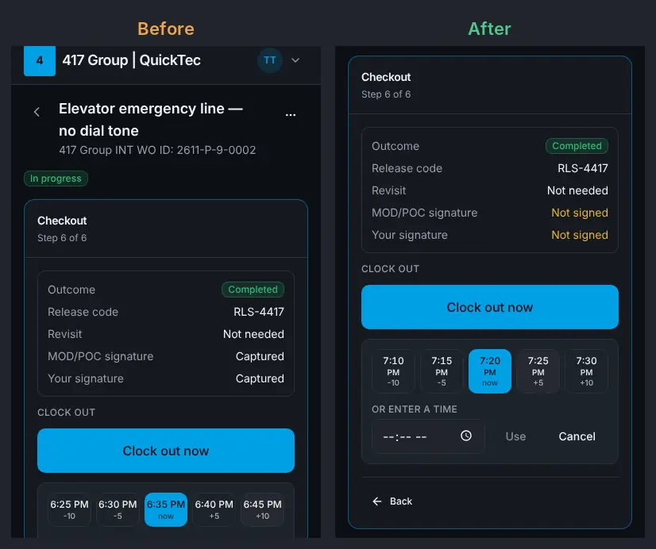

The clock picker from ten o'clock on.

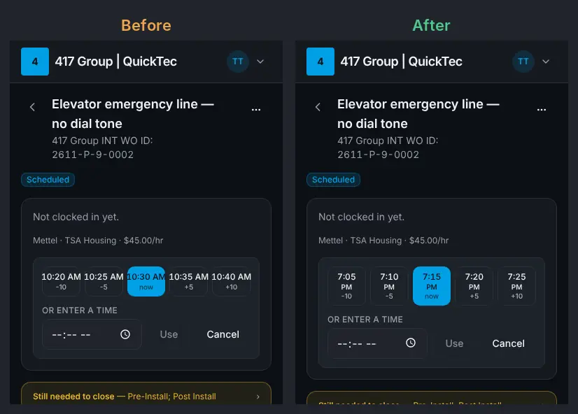

Settings → Users.

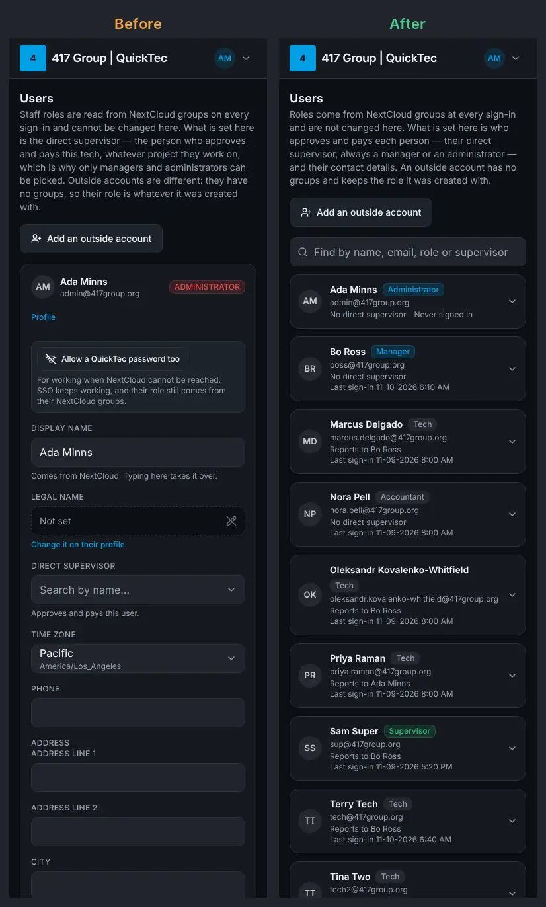

The Jobs list: the time had been the part cut off.

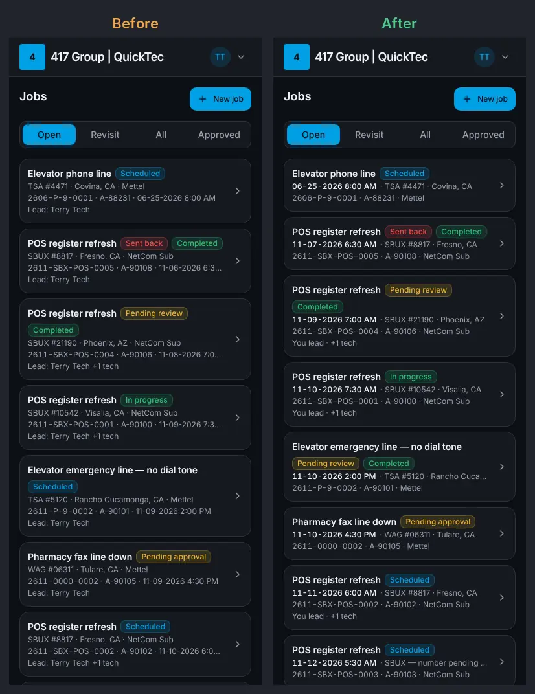

The dashboard's week on a phone.

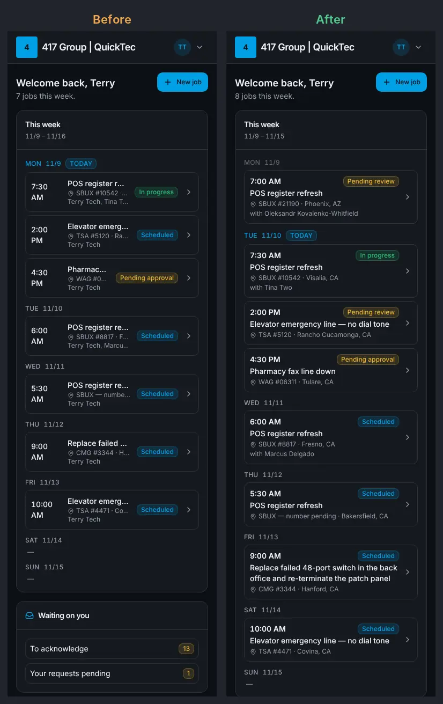

Approvals: what a change request said.

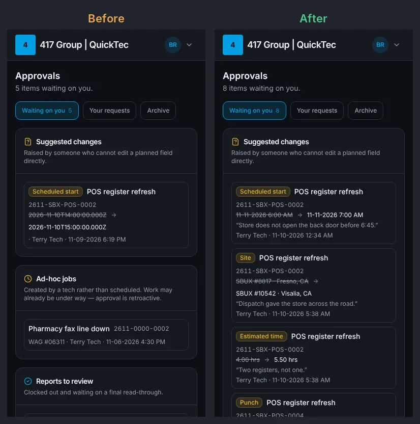

A page that is not there.

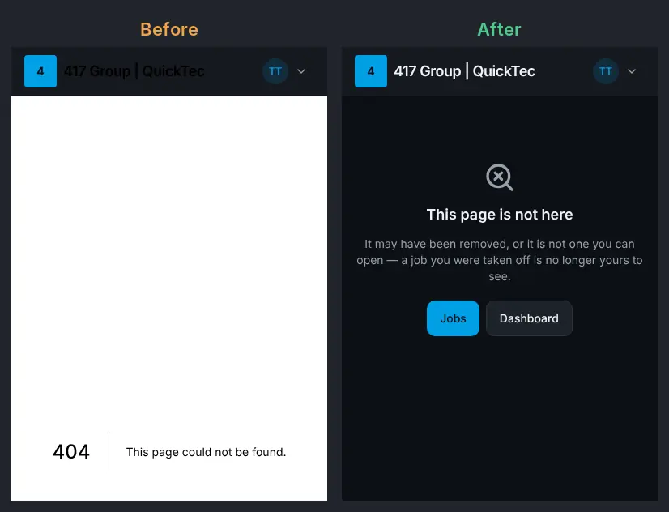

Somebody else's profile on a phone.

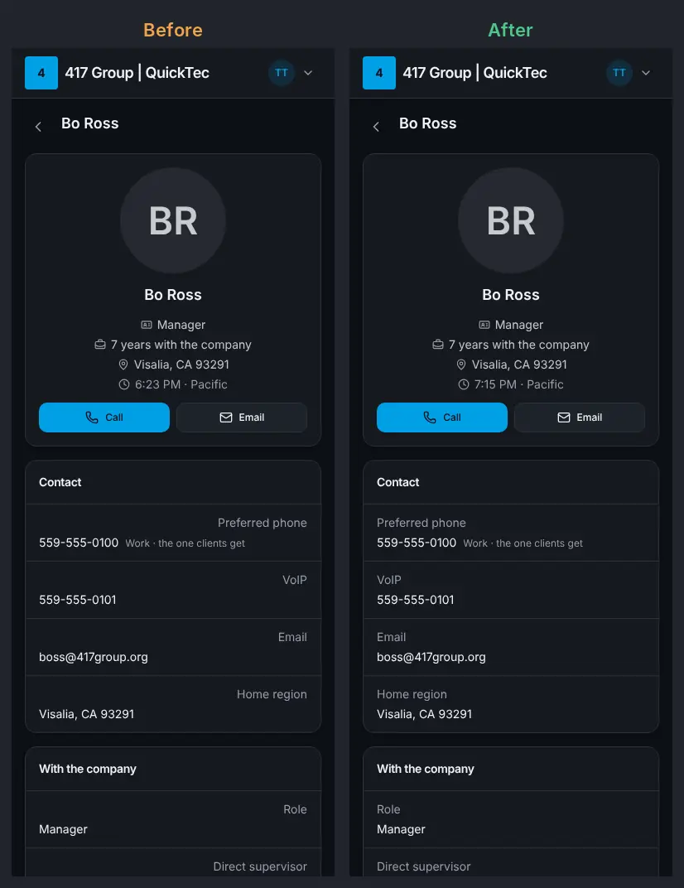

Assignment details on a phone, after the owner's answer 4.

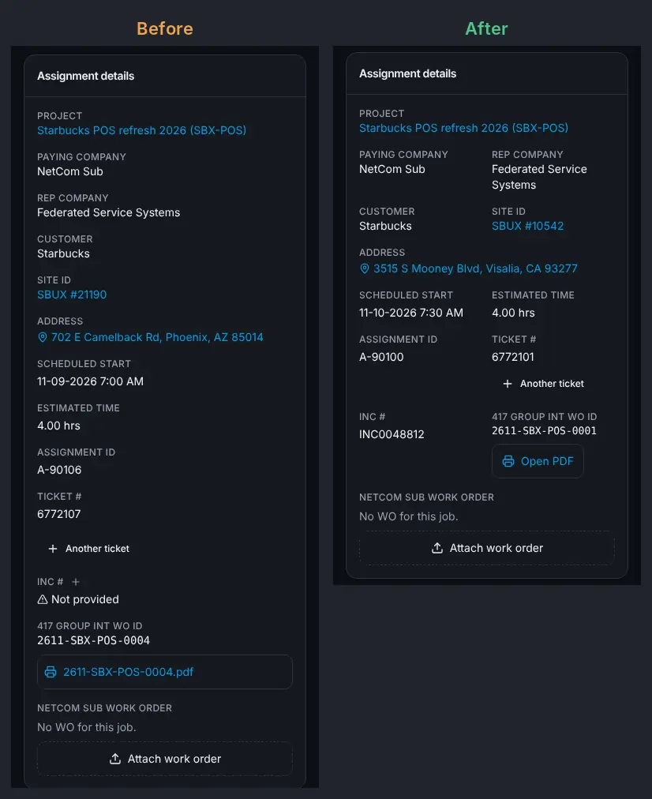

Statistics, after the owner's answer 10.

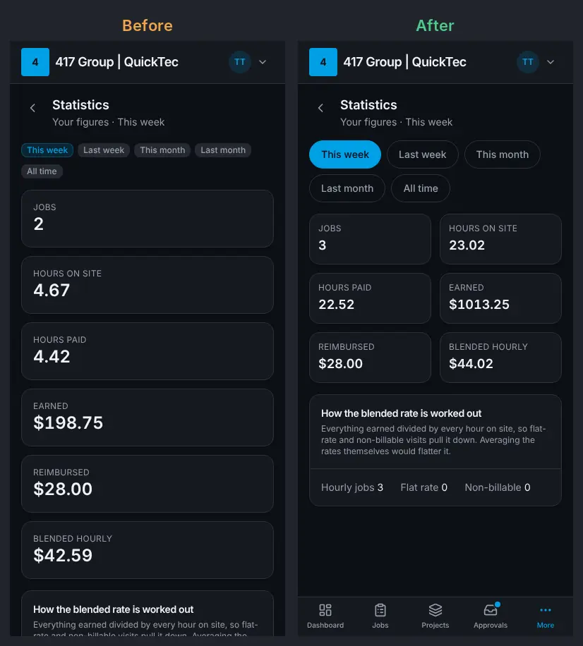

The five control styles behind proposal 8.

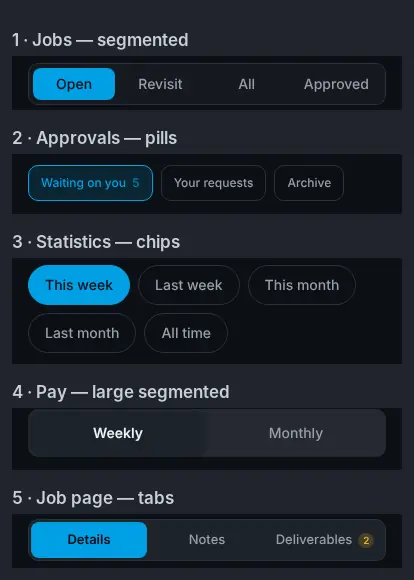
